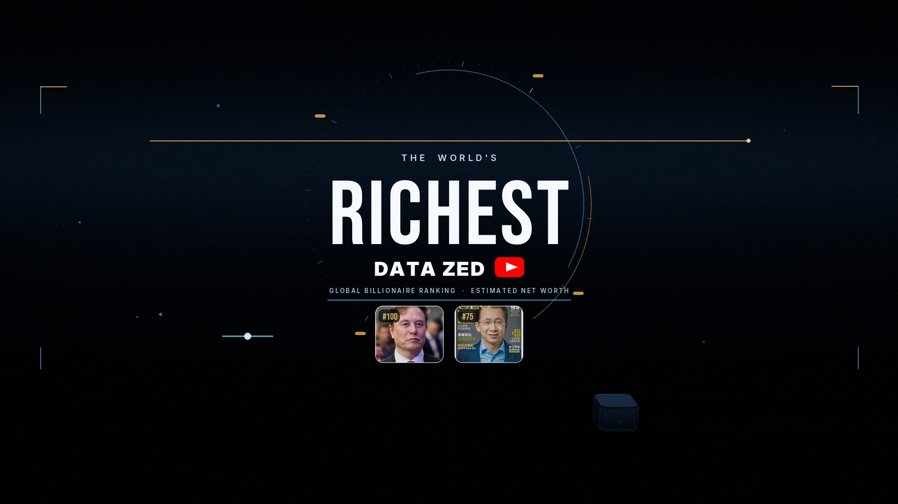

# datavidskill

A small engine that turns a ranked dataset into a **3D tower data film**: each tower grows from the floor when its item is revealed, with a front-facing lateral camera, softly chamfered cuboids or topic-selected cylinders, vivid opaque solid materials by default, with a locally cached licensed image inset safely on its front face and a fixed-size enlarged portrait card in reserved screen space. Glass is optional; graphics are rendered locally, while licensed subject images are sourced separately and attributed.

The reference film in `projects/richest-2026` is a 3:00 documentary on the Forbes 2026 billionaires, from #1 (Dilip Shanghvi, $25.6B) to #100 (Elon Musk, $839B).

[Watch the reference film](https://github.com/xwiperx/datavidskill/releases) · 1920×1080 · 30 fps · H.264 + AAC · 3:00



## Use it as a skill

`dist/datavid.skill` is the packaged skill, built from the current `SKILL.md`, references, templates, renderer, image resolver, QA tools, and fonts. Attach it to a Manus task and give a topic — e.g. "a 3-minute video of the 100 tallest buildings" — and the agent will guide topic selection, research, storyboard review, and production gates.

## Quick start

```bash
python3 scripts/new_project.py my-project          # config.json + data.json
# edit data.json (items: name, value, category, meta) and config.json (titles, units)
python3 scripts/datavid/fetch_images.py --project my-project  # optional, license-aware Wikimedia images
python3 scripts/render.py --project my-project --stills 3 8 18 40
```

`--stills` writes PNGs to `my-project/stills/` for preview and layout checks. A full render is a separate release step: first complete the current storyboard, obtain explicit approval, choose output resolution(s), and pass the production gates in `references/production-gates.md`; only then run `python3 scripts/render.py --project my-project --workers 6`. The CLI itself does not collect approval. Renders are written to `my-project/out/` with no-clobber naming. `--audio-only` refreshes the raw score and invalidates the normalized score cache so the next full render regenerates it.

Requirements: Python 3.10+, Pillow, NumPy, ffmpeg with libx264. Fonts are bundled (Bebas Neue, Inter).

## How the film is built

| Section | Timing | What happens |
|---|---|---|
| Intro | 0–12 s | animated numerical reticle, portrait teaser, title lockup, and camera push-in |
| Countdown | 12 s → `duration−22 s` | each softened cuboid rises from the floor on its turn; the straight-on camera tracks laterally across several columns with HUD, an inset portrait and oversized rank numeral on each front face, a fixed large portrait card, and a lower third |
| Finale | last 22 s − 12 s | camera pulls back on the #1 tower, right-hand title block with the value and two stats |
| End card | last 8.6 s | the whole list as a colour ribbon, the total, Data Zed channel branding |

Height blends a value curve and a rank progression so even near-ties grow visibly. `height_rank_mix: 0` selects the pure value curve. The active column rises from the floor over the first `growth_fraction` of its reveal and then holds at full height for reading; the default `0.46` leaves a visible stable hold. Camera framing is fixed vertically to keep the change in height visible rather than auto-zooming each tower to the same size.

## Images and appearance

`scripts/datavid/fetch_images.py` checks Wikipedia and Wikimedia Commons, accepts public-domain, CC0, CC BY, and CC BY-SA assets, downloads images into the project, and records artist/license/source links in `image_sources.json`. Choose `visual_mode` (`person`, `country`/`flag`, `vehicle`, `building`, `company`, or `auto`) in `config.json`, or override a row with `visual_type`, `image_query`, and (for flags) `country`. Country entries use flags; person entries use exact-person portraits. Review matches and retain the attribution manifest when redistributing. If no exact, licensed image is found, the renderer leaves the portrait window empty rather than showing an unrelated result.

Choose `geometry` (`beveled_box` or `cylinder`), `material` (`solid` by default; `metal` or translucent `glass` optional), `bevel_radius`, `camera_front`, `camera_lead_steps`, `image_shape` (`square` or `circle`), `image_placement`, and `brand`; choose any RGB color ramp in `colors` / `color_positions`. Before approval, inspect representative stills for text collisions, clipping, transparency, and rendering artifacts. The channel name appears prominently beneath the intro title and beside a YouTube play mark when requested; the optional intro subtitle defaults to blank.

## Repository layout

```
SKILL.md                  the agent-facing skill (workflow, config reference, quality bar)
scripts/render.py         CLI: stills or full render
scripts/new_project.py    scaffold a project folder
scripts/datavid/          engine.py (3D + post), hud.py, scene.py (timeline), audio.py, build.py, fetch_images.py
scripts/datavid/fonts/    bundled typefaces
templates/                config.json and data.json templates
references/               data sourcing and QA/pitfall notes
projects/richest-2026/    reference project (config, data, raw Forbes JSON, licensed portraits, Data Zed channel branding, and MP4)
docs/preview.jpg          still from the film
```

## The reference project

`projects/richest-2026/data.json` holds 100 people sorted ascending by net worth, with `category` (industry) and `meta` (company · country). `source/forbes2026.json` is the Forbes API snapshot (March 2026); `source/build_data.py` plus `source/data_overrides.json` deterministically build the curated output. The current local portrait cache contains 61 assets; 39 entries intentionally have no cached image. See `projects/richest-2026/IMAGE_COVERAGE.md` and `image_sources.json` for ranks and source/credit records. Total: $7.12T.

```bash
python3 scripts/render.py --project projects/richest-2026 --stills 75
```
