# استوری‌بورد بازبینی — مستند ثروتمندترین افراد، Data Zed

**پیش‌نویس بازبینی · ۱۸۰ ثانیه · ۱۹۲۰×۱۰۸۰ · ۳۰fps · دوربین روبه‌رو · ستون‌های منشوری نرم و مات**

این نسخهٔ تازه ستون‌های منشوری مکعبی، پررنگ و مات با گوشه‌های نرم را حفظ می‌کند. تصویر تأییدشده روی وجه ستون کوچک و با حاشیهٔ امن از پخ‌ها/خطوط می‌نشیند؛ هم‌زمان همان پرتره در قاب بزرگِ هم‌اندازه و ثابت در فضای خالی سمت راست نمایش داده می‌شود. برای فرد فاقد تصویر تأییدشده، قاب بزرگ خالی می‌ماند و هیچ تصویر نامرتبطی جایگزین نمی‌شود. شمارهٔ رتبه روی نیمهٔ پایینی وجه ستون بسیار بزرگ شده است. پلاک شناور در ناحیهٔ امن ثابت، بیرون از محدودهٔ قاب پرتره و lower-third قرار می‌گیرد؛ در برخوردهای فرضی، جای پلاک عوض/بازچینی می‌شود و هرگز بی‌صدا حذف نمی‌شود. برند DATA ZED و نشان YouTube، چیدمان مقدمه و پایان‌کارت طبق طرح مصوب قبلی حفظ شده‌اند.

برداشت cadence در این پیش‌نویس: رتبه‌های ۱ تا ۹۰ همچنان تک‌به‌تک معرفی و قابل‌خواندن‌اند، اما در انتهای هر فصل ده‌رتبه‌ای یک ضربهٔ رشد/ترنزیشن برجسته در رتبه‌های ۱۰، ۲۰، …، ۹۰ می‌آید. رتبه‌های ۹۱ تا ۱۰۰ هرکدام رشد مستقل و مکث خواندنی خودشان را دارند. هر ستون در ۴۶٪ نخست نوبتش بالا می‌آید و سپس برای خواندن اطلاعات مکث می‌کند.

## مقدمهٔ بازطراحی‌شده

این پیشنهاد، مقدمه را به یک لوگو-استینگ ۱۲ثانیه‌ای تبدیل می‌کند: ورود نور و قاب‌های گوشه‌ای، حرکت نرم عنوان، نشستن لوگوی Data Zed و نشان YouTube، نمایش کوتاه چهره‌های نمونه، سپس آشکارشدن موضوع «ارزش خالص میلیارد‌درها» و جمع‌شدن گرافیک برای ورود به رتبهٔ اول. افکت‌ها در حاشیه و فضای خالی می‌مانند تا عنوان و اطلاعات روی هم نیفتند.

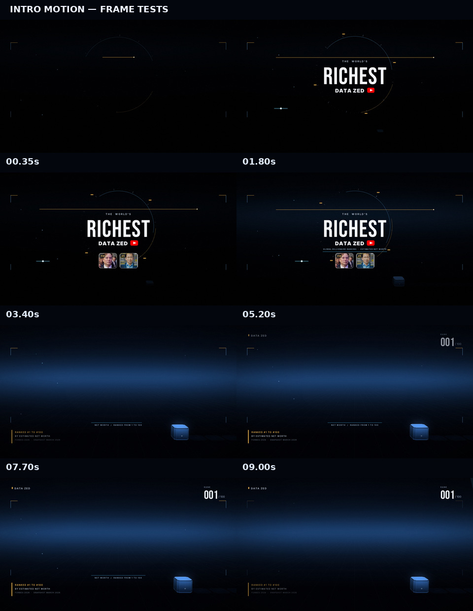

## نمونهٔ رشد منشور مکعبی

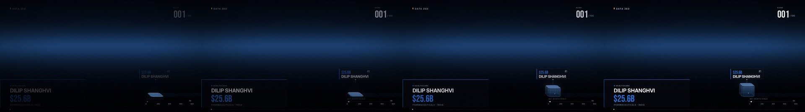

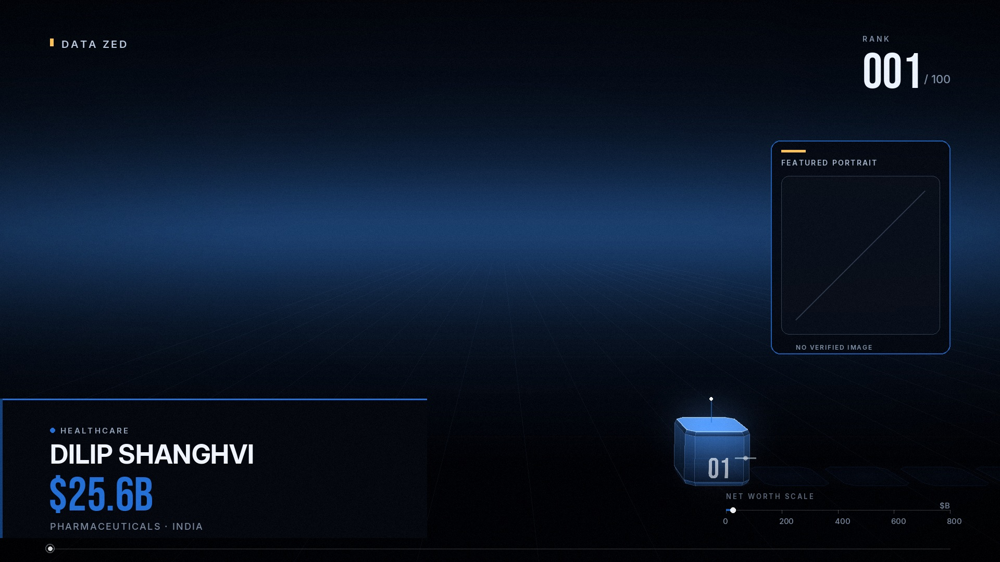

## فریم‌های مکث هر ۱۰۰ رتبه

در صورت وجود تصویرِ دقیق و دارای مجوز، پنجرهٔ مربعی هم‌اندازه در بخش بالایی وجه جلوی ستون قرار می‌گیرد. اندازهٔ عکس روی ستون برای برج کوتاه به‌طور تطبیقی کوچک می‌شود، نه اینکه صرفاً به‌دلیل ارتفاع پیش‌فرض حذف شود. هیچ تصویر نامرتبطی جایگزین نشده است. فریم‌های مکث و تماس‌شیت‌های این نسخه با timing جدید بازتولید شده‌اند.

### رتبه‌های 1 تا 25

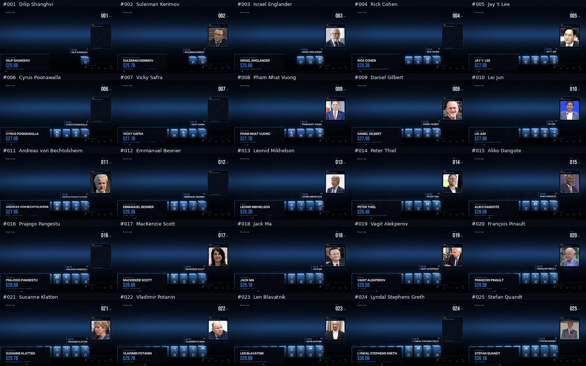

| رتبه | زمان فریم مکث (ثانیه) | نام | دارایی خالص تخمینی |
|---:|---:|---|---:|
| 1 | 12.95 | Dilip Shanghvi | $25.6B |
| 2 | 14.41 | Suleiman Kerimov | $25.7B |
| 3 | 15.87 | Israel Englander | $25.8B |
| 4 | 17.33 | Rick Cohen | $26.3B |
| 5 | 18.79 | Jay Y. Lee | $27.0B |
| 6 | 20.25 | Cyrus Poonawalla | $27.0B |
| 7 | 21.71 | Vicky Safra | $27.1B |
| 8 | 23.17 | Pham Nhat Vuong | $27.7B |
| 9 | 24.63 | Daniel Gilbert | $27.9B |
| 10 | 26.09 | Lei Jun | $27.9B |
| 11 | 27.55 | Andreas von Bechtolsheim | $27.9B |
| 12 | 29.01 | Emmanuel Besnier | $28.3B |
| 13 | 30.47 | Leonid Mikhelson | $28.3B |
| 14 | 31.93 | Peter Thiel | $28.4B |
| 15 | 33.39 | Aliko Dangote | $28.5B |
| 16 | 34.85 | Prajogo Pangestu | $28.6B |
| 17 | 36.31 | MacKenzie Scott | $28.6B |
| 18 | 37.77 | Jack Ma | $29.1B |
| 19 | 39.23 | Vagit Alekperov | $29.5B |
| 20 | 40.69 | François Pinault | $29.5B |
| 21 | 42.15 | Susanne Klatten | $29.7B |
| 22 | 43.61 | Vladimir Potanin | $29.7B |
| 23 | 45.07 | Len Blavatnik | $29.9B |
| 24 | 46.53 | Lyndal Stephens Greth | $30.0B |
| 25 | 47.99 | Stefan Quandt | $30.1B |

### رتبه‌های 26 تا 50

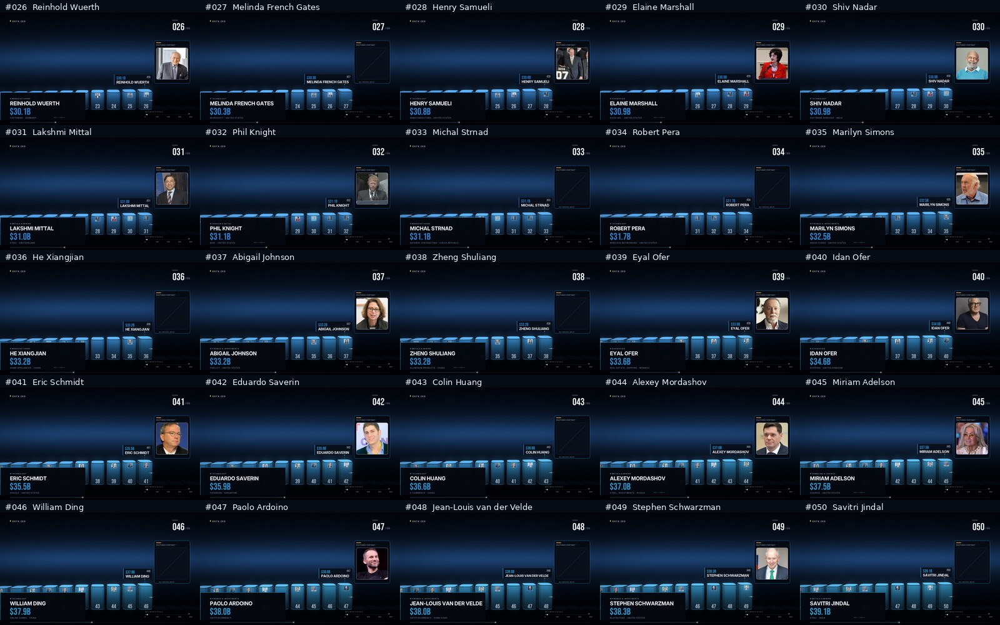

| رتبه | زمان فریم مکث (ثانیه) | نام | دارایی خالص تخمینی |
|---:|---:|---|---:|
| 26 | 49.45 | Reinhold Wuerth | $30.1B |
| 27 | 50.91 | Melinda French Gates | $30.3B |
| 28 | 52.37 | Henry Samueli | $30.8B |
| 29 | 53.83 | Elaine Marshall | $30.9B |
| 30 | 55.29 | Shiv Nadar | $30.9B |
| 31 | 56.75 | Lakshmi Mittal | $31.0B |
| 32 | 58.21 | Phil Knight | $31.1B |
| 33 | 59.67 | Michal Strnad | $31.1B |
| 34 | 61.13 | Robert Pera | $31.7B |
| 35 | 62.59 | Marilyn Simons | $32.5B |
| 36 | 64.05 | He Xiangjian | $33.2B |
| 37 | 65.51 | Abigail Johnson | $33.2B |
| 38 | 66.97 | Zheng Shuliang | $33.2B |
| 39 | 68.43 | Eyal Ofer | $33.6B |
| 40 | 69.89 | Idan Ofer | $34.6B |
| 41 | 71.35 | Eric Schmidt | $35.5B |
| 42 | 72.81 | Eduardo Saverin | $35.9B |
| 43 | 74.27 | Colin Huang | $36.6B |
| 44 | 75.73 | Alexey Mordashov | $37.0B |
| 45 | 77.19 | Miriam Adelson | $37.5B |
| 46 | 78.65 | William Ding | $37.9B |
| 47 | 80.11 | Paolo Ardoino | $38.0B |
| 48 | 81.57 | Jean-Louis van der Velde | $38.0B |
| 49 | 83.03 | Stephen Schwarzman | $38.3B |
| 50 | 84.49 | Savitri Jindal | $39.1B |

### رتبه‌های 51 تا 75

| رتبه | زمان فریم مکث (ثانیه) | نام | دارایی خالص تخمینی |
|---:|---:|---|---:|
| 51 | 85.95 | Alain Wertheimer | $39.4B |
| 52 | 87.41 | Gerard Wertheimer | $39.4B |
| 53 | 88.87 | Thomas Frist Jr. | $41.1B |
| 54 | 90.33 | Klaus-Michael Kuehne | $41.9B |
| 55 | 91.79 | Andrea Pignataro | $42.6B |
| 56 | 93.25 | Gianluigi Aponte | $44.5B |
| 57 | 94.71 | Rafaela Aponte-Diamant | $44.5B |
| 58 | 96.17 | Mark Mateschitz | $45.8B |
| 59 | 97.63 | Li Ka-shing | $47.0B |
| 60 | 99.09 | Giovanni Ferrero | $48.8B |
| 61 | 100.55 | Lukas Walton | $48.9B |
| 62 | 102.01 | Jacqueline Mars | $49.1B |
| 63 | 103.47 | John Mars | $49.1B |
| 64 | 104.93 | Ken Griffin | $49.8B |
| 65 | 106.39 | Masayoshi Son | $51.5B |
| 66 | 107.85 | Iris Fontbona | $52.6B |
| 67 | 109.31 | Robin Zeng | $53.2B |
| 68 | 110.77 | Ma Huateng | $53.8B |
| 69 | 112.23 | Tadashi Yanai | $61.8B |
| 70 | 113.69 | Gautam Adani | $63.8B |
| 71 | 115.15 | Germán Larrea Mota Velasco | $67.1B |
| 72 | 116.61 | Dieter Schwarz | $67.2B |
| 73 | 118.07 | Jeff Yass | $67.4B |
| 74 | 119.53 | Zhong Shanshan | $68.1B |
| 75 | 120.99 | Zhang Yiming | $69.3B |

### رتبه‌های 76 تا 100

| رتبه | زمان فریم مکث (ثانیه) | نام | دارایی خالص تخمینی |
|---:|---:|---|---:|
| 76 | 122.45 | Charles Koch | $73.8B |
| 77 | 123.91 | Julia Koch | $81.2B |
| 78 | 125.37 | Thomas Peterffy | $82.9B |
| 79 | 126.83 | Giancarlo Devasini | $89.3B |
| 80 | 128.29 | Mukesh Ambani | $99.7B |
| 81 | 129.75 | Francoise Bettencourt Meyers | $100.0B |
| 82 | 131.21 | Bill Gates | $108.0B |
| 83 | 132.67 | Michael Bloomberg | $109.0B |
| 84 | 134.13 | Changpeng Zhao | $110.0B |
| 85 | 135.59 | Carlos Slim Helu | $125.0B |
| 86 | 137.05 | Steve Ballmer | $126.0B |
| 87 | 138.51 | Alice Walton | $134.0B |
| 88 | 139.97 | Michael Dell | $141.0B |
| 89 | 141.43 | Jim Walton | $143.0B |
| 90 | 142.89 | Rob Walton | $146.0B |
| 91 | 144.35 | Amancio Ortega | $148.0B |
| 92 | 145.81 | Warren Buffett | $149.0B |
| 93 | 147.27 | Jensen Huang | $154.0B |
| 94 | 148.73 | Bernard Arnault | $171.0B |
| 95 | 150.19 | Larry Ellison | $190.0B |
| 96 | 151.65 | Mark Zuckerberg | $222.0B |
| 97 | 153.11 | Jeff Bezos | $224.0B |
| 98 | 154.57 | Sergey Brin | $237.0B |
| 99 | 156.03 | Larry Page | $257.0B |
| 100 | 157.49 | Elon Musk | $839.0B |

## پوشش تصویرها

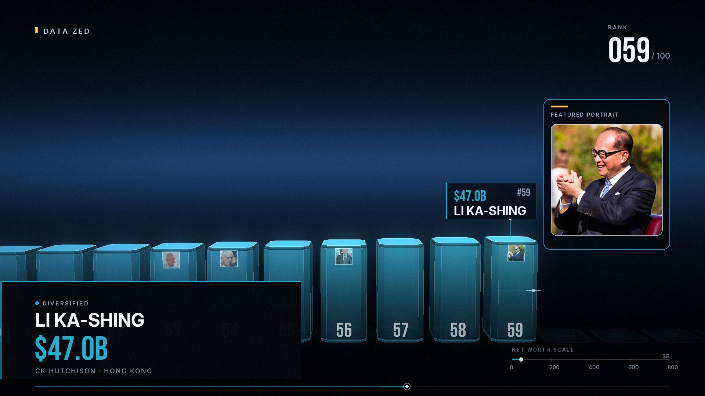

۶۹ پرترهٔ دقیق و دارای مجوز موجود است؛ برای ۳۱ نفر تصویر مناسب و تأییدشده یافت نشده و قابشان عمداً خالی است. جزئیات در [IMAGE_COVERAGE.md](../IMAGE_COVERAGE.md) و `image_sources.json` است.

## اوج و پایان

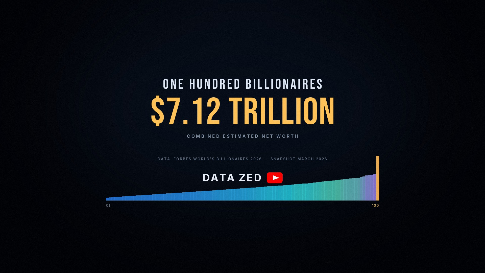

اوترو پیشنهادی از اوج رتبهٔ ۱۰۰ با تاریک‌شدن کنترل‌شده به کارت پایانی می‌رسد؛ نوار رتبه‌ها مرحله‌به‌مرحله روشن می‌شود، اسکن نوری از روی آن می‌گذرد و حلقه‌های ظریف داده‌ای و درخشش‌های کناری حرکت را کامل می‌کنند. عنوان و رقم کل برای مکث خواندنی ثابت می‌مانند و محو نهایی نرم است.

## بازبینی

این سند، پیش‌نمایش طرح است؛ MP4 کامل سه‌دقیقه‌ای پس از تأیید صریح همین نسخهٔ استوری‌بورد ساخته می‌شود. تماس‌شیت‌های رتبه‌ها و QA مرزها فریم‌های نمونه/مکث هستند، نه رندر ویدیوی کامل.

## موشن‌گرافیک در شمارش معکوس و cadence رشد — نسخهٔ تازه برای بازبینی

هر رتبهٔ ۱ تا ۹۰ به‌صورت مستقل معرفی و رشد داده می‌شود؛ در انتهای هر فصل ده‌رتبه‌ای (رتبه‌های ۱۰، ۲۰، …، ۹۰) یک تأکید فصل/ترنزیشن قوی‌تر قرار دارد. این برداشت پیشنهادی از «بین هر ۱۰ رتبه» است. رتبه‌های ۹۱ تا ۱۰۰ هرکدام یک رشد مجزا و مکث خواندنی دارند؛ آن‌ها با هم ادغام نمی‌شوند. در هر رشد، اسکن نور، روشن‌شدن لبهٔ بالا و پالس نوار پیشرفت با رنگ ستون هماهنگ است.

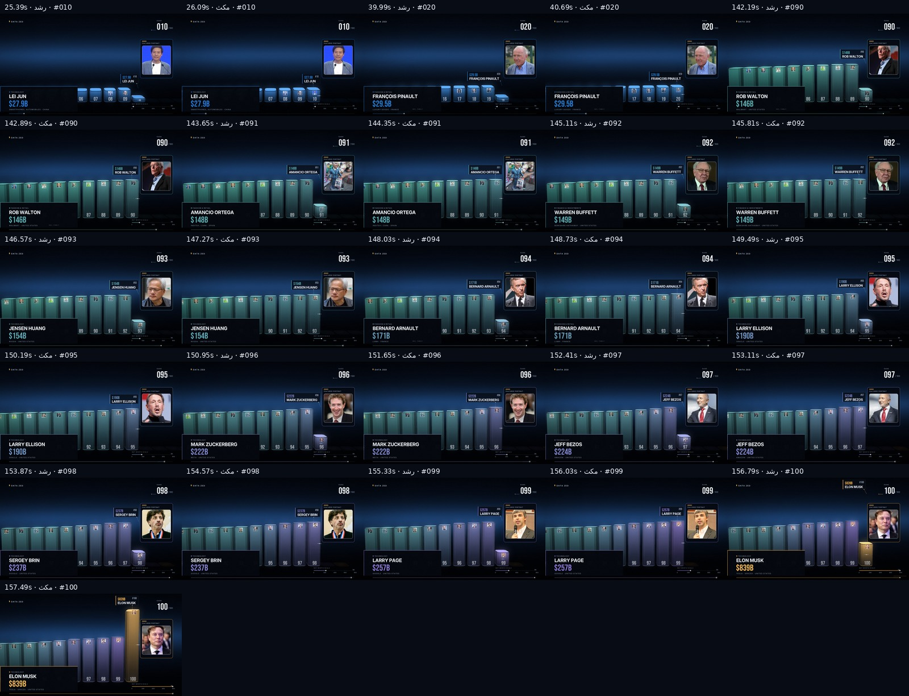

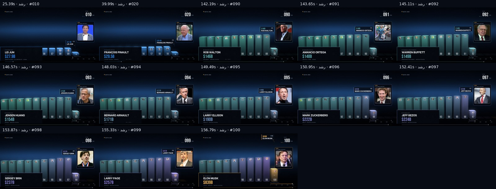

| نمونهٔ فریم | زمان (ثانیه) | اتفاق |
|---|---:|---|
| رتبهٔ ۱۰ — رشد / مکث | 25.39 / 26.09 | پایان فصل نخست ده‌رتبه‌ای |
| رتبهٔ ۲۰ — رشد / مکث | 39.99 / 40.69 | تأکید فصل دوم |
| رتبهٔ ۹۰ — رشد / مکث | 142.19 / 142.89 | پایان بازهٔ فصل‌های ده‌تایی |
| رتبهٔ ۹۱ — رشد / مکث | 143.65 / 144.35 | آغاز رشدهای مستقل ده رتبهٔ پایانی |
| رتبهٔ ۹۵ — رشد / مکث | 149.49 / 150.19 | نمونهٔ میانی بخش پایانی |
| رتبهٔ ۱۰۰ — رشد / مکث | 156.79 / 157.49 | رشد نهایی تا ارتفاع واقعی و مکث اوج |

در همهٔ ۱۰۰ رتبه تماس‌شیت‌های مکث از نسخهٔ فعلی کد بازسازی شده‌اند. قاب بزرگ پرتره هم‌اندازه و در مختصات ثابت صفحه می‌ماند؛ در صورت نبود تصویر دقیق و تأییدشده، قاب خالی است. عکس کوچک روی وجه ستون داخل محدودهٔ تختِ وجه و دور از پخ‌ها و خطوط قرار می‌گیرد؛ برای برج کوتاه، عکس در ناحیهٔ امن کوچک می‌شود. شماره در ناحیهٔ پایین و تقریباً به اندازهٔ نیمی از ارتفاع وجه نمایش داده می‌شود. پلاک شناور در ناحیهٔ امنِ جدا از پنل پرتره و lower-third قرار دارد و نام/رتبه در پلاک برای همهٔ رتبه‌ها حفظ می‌شود.

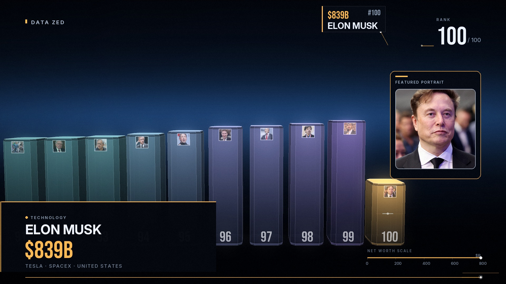

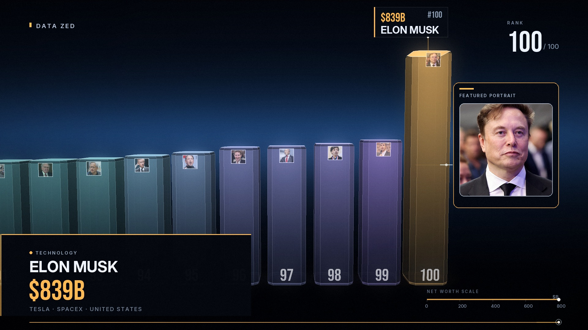

## زمان‌بندی هماهنگ و QA مرزها — نسخهٔ تازه برای تأیید

برای رتبهٔ `i`، شروع دقیق `12.00 + (i−1) × 1.46` ثانیه و پایان `12.00 + i × 1.46` ثانیه است. در همان شروع، رشد ستون، topbar، lower-third، پلاک نام/دارایی و قاب بزرگ تصویر همان رتبه فعال می‌شوند. یک envelope مشترک کوتاه روی عناصر هویتی اعمال می‌شود؛ اطلاعات رتبهٔ قبلی پیش از مرز پاک می‌شوند. در پایان رتبهٔ ۱۰۰ نیز topbar، پلاک و قاب بزرگ بلافاصله کنار می‌روند.

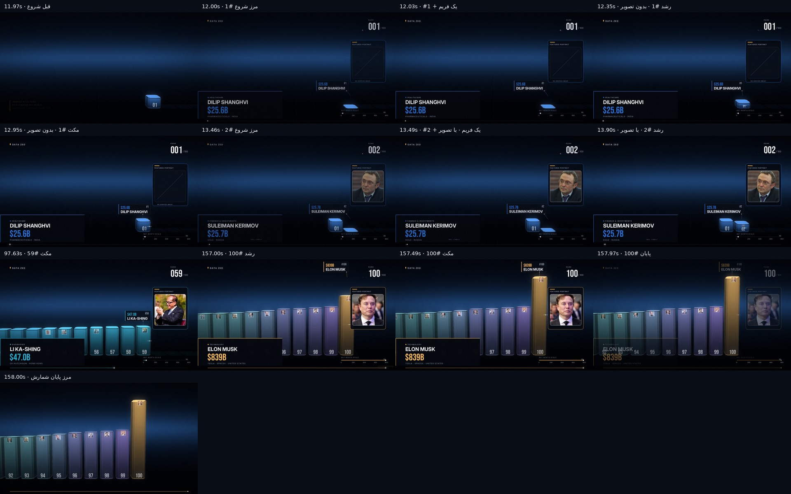

تماس‌شیت موشن تازه، رشد و مکث رتبه‌های ۱۰، ۲۰، ۹۰ و تک‌تک رتبه‌های ۹۱ تا ۱۰۰ را کنار هم نشان می‌دهد؛ تماس‌شیت رشد نیز فریم رشدِ هرکدام از این فصل‌ها را جدا می‌کند.

چهار تماس‌شیت بالاتر، فریم مکث تازهٔ هر ۱۰۰ رتبه را نشان می‌دهند. در ردیف‌های دارای تصویر، قاب بزرگ و عکس روی ستون از همان داراییِ تأییدشده‌اند؛ برای ۳۱ رتبهٔ فاقد دارایی، قاب بزرگ با پیام `NO VERIFIED IMAGE` خالی می‌ماند. پوشش کنونی ۶۹/۱۰۰ است؛ هیچ جانشین نامرتبطی استفاده نشده.

## بازبینی نهایی طرح

این فایل و تصاویر پیوندخورده پیش‌نمایش storyboard هستند؛ در این مرحله هیچ MP4 کامل سه‌دقیقه‌ای رندر نشده است. فریم‌های مرزی و تماس‌شیت‌های تمام ۱۰۰ رتبه از نسخهٔ اصلاح‌شده بازتولید شده‌اند. لطفاً زمان شروع/پایان هر رتبه، حضور متن و قاب بزرگ در نمونهٔ مرزی، فاصلهٔ متن‌ها و cadence رشد را بررسی کنید. فقط پس از تأیید صریح همین نسخه و انتخاب کیفیت(های) خروجی، رندر کامل MP4 آغاز می‌شود.
