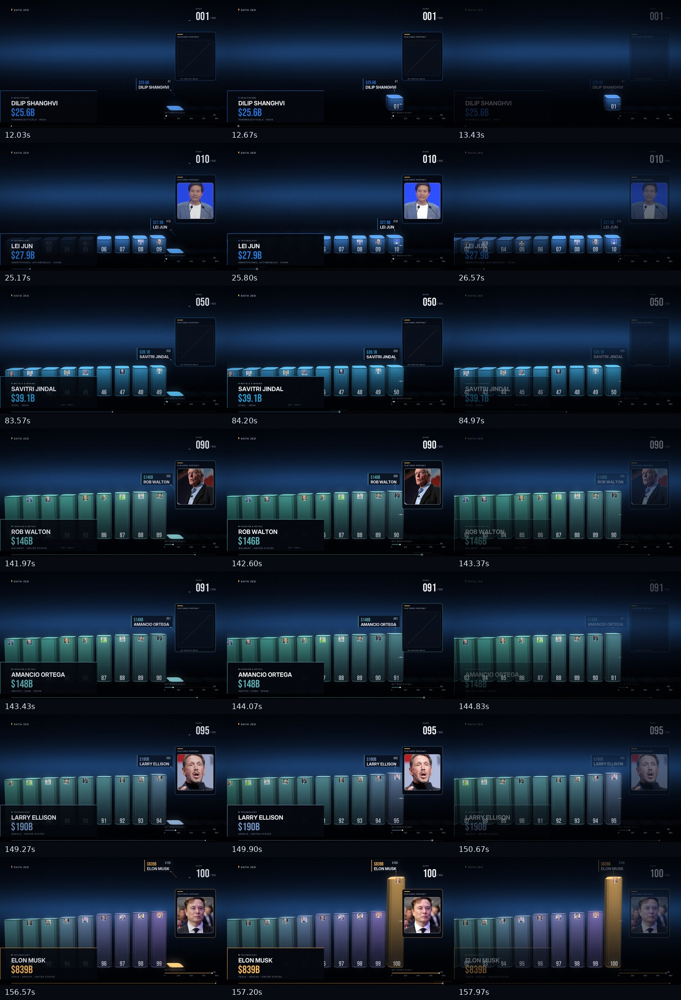
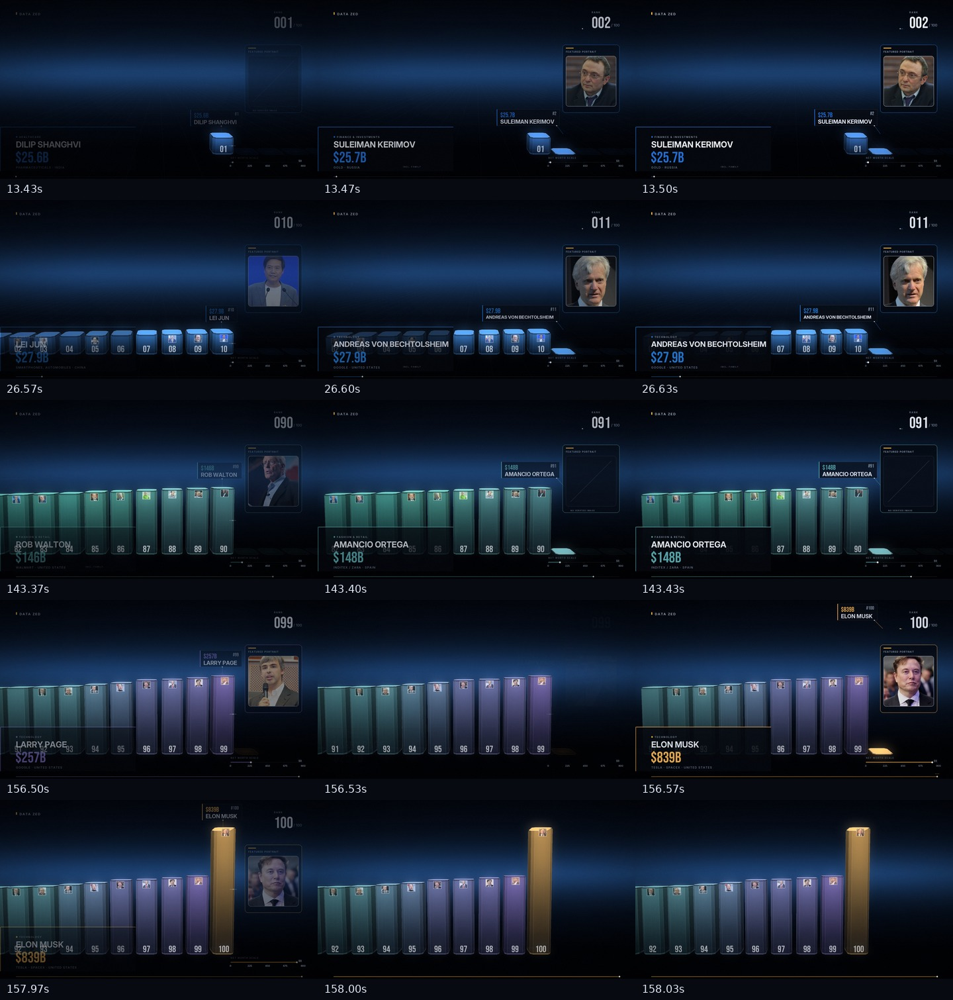
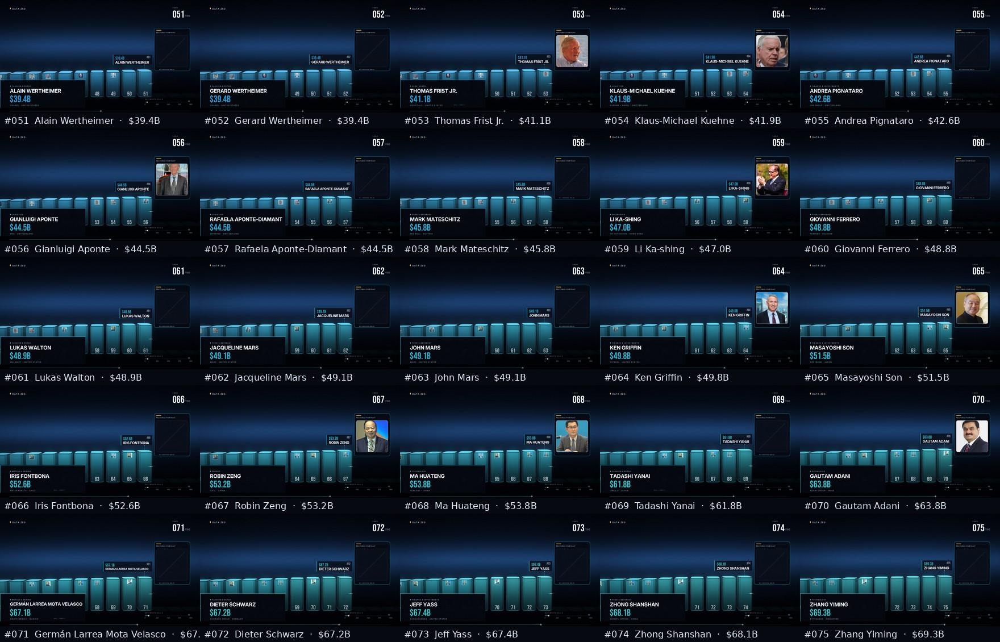
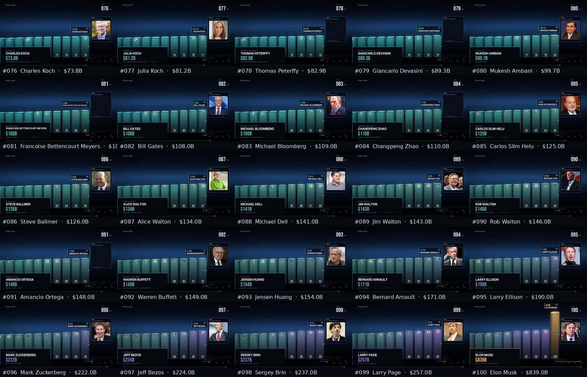
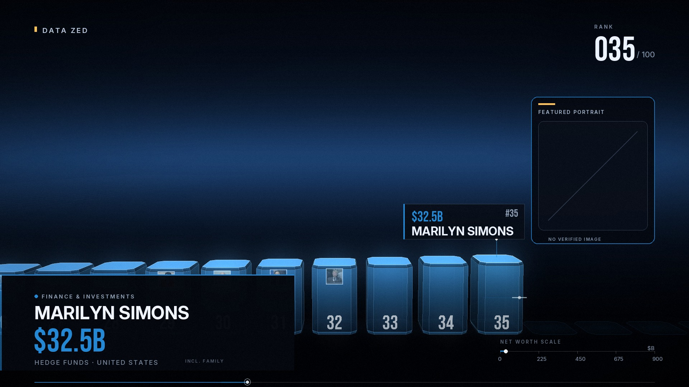
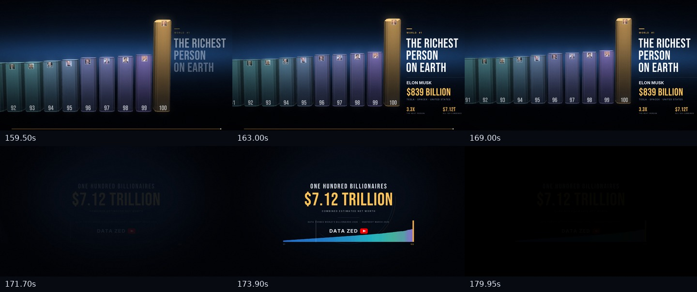

# استوری‌بورد تازهٔ «ثروتمندترین افراد جهان» — Data Zed

این پیش‌نمایش پس از ممیزی تازهٔ داده/تصویر، HUD، projection و پایان‌کارت بازتولید شده است. تماس‌شیت‌های ۱ تا ۱۰۰ فریم مکث واقعیِ نسخهٔ فعلی‌اند؛ sequenceها نمونه‌های ثابت از موشن‌اند و هنوز ویدیوی کامل نیستند.

## مقدمه و هویت بصری

نام Data Zed و نشان YouTube زیر عنوان RICHEST قرار دارد. سطر توضیحی «one hundred people - one number each» عمداً درج نشده است. ستون‌ها مات، اشباع و نرم‌لبه‌اند؛ عنوان، عددها و عکس‌ها در نواحی مجزا نگه داشته شده‌اند.

نمونهٔ رشد در سه لحظه (شروع، انتهای rise، مکث) برای رتبه‌های آغازین، میانی، مرز فصل‌ها و ده رتبهٔ پایانی؛ همچنین سه‌فریم قبل/لحظه/بعد از چند مرز رتبه و انتقال شمارش به اوج در این تماس‌شیت‌ها آمده است.

## مکث‌های رتبه‌ها

هر رتبه یک رشد مستقل دارد؛ فصل‌بندی ۱۰تایی تا رتبهٔ ۹۰ و رشدهای مجزای ۹۱ تا ۱۰۰ حفظ شده‌اند. نوار پیشرفت اکنون در شیار پایین مستقل از lower-third است؛ نام‌های بلند با کوچک‌سازی و در صورت لزوم ellipsis مهار می‌شوند.

### رتبه‌های 1 تا 25

| رتبه | زمان مکث (ثانیه) | نام | ارزش تخمینی |
|---:|---:|---|---:|
| 1 | 12.99 | Dilip Shanghvi | $25.6B |
| 2 | 14.45 | Suleiman Kerimov | $25.7B |
| 3 | 15.91 | Israel Englander | $25.8B |
| 4 | 17.37 | Rick Cohen | $26.3B |
| 5 | 18.83 | Jay Y. Lee | $27.0B |
| 6 | 20.29 | Cyrus Poonawalla | $27.0B |
| 7 | 21.75 | Vicky Safra | $27.1B |
| 8 | 23.21 | Pham Nhat Vuong | $27.7B |
| 9 | 24.67 | Daniel Gilbert | $27.9B |
| 10 | 26.13 | Lei Jun | $27.9B |
| 11 | 27.59 | Andreas von Bechtolsheim | $27.9B |
| 12 | 29.05 | Emmanuel Besnier | $28.3B |
| 13 | 30.51 | Leonid Mikhelson | $28.3B |
| 14 | 31.97 | Peter Thiel | $28.4B |
| 15 | 33.43 | Aliko Dangote | $28.5B |
| 16 | 34.89 | Prajogo Pangestu | $28.6B |
| 17 | 36.35 | MacKenzie Scott | $28.6B |
| 18 | 37.81 | Jack Ma | $29.1B |
| 19 | 39.27 | Vagit Alekperov | $29.5B |
| 20 | 40.73 | François Pinault | $29.5B |
| 21 | 42.19 | Susanne Klatten | $29.7B |
| 22 | 43.65 | Vladimir Potanin | $29.7B |
| 23 | 45.11 | Len Blavatnik | $29.9B |
| 24 | 46.57 | Lyndal Stephens Greth | $30.0B |
| 25 | 48.03 | Stefan Quandt | $30.1B |

### رتبه‌های 26 تا 50

| رتبه | زمان مکث (ثانیه) | نام | ارزش تخمینی |
|---:|---:|---|---:|
| 26 | 49.49 | Reinhold Wuerth | $30.1B |
| 27 | 50.95 | Melinda French Gates | $30.3B |
| 28 | 52.41 | Henry Samueli | $30.8B |
| 29 | 53.87 | Elaine Marshall | $30.9B |
| 30 | 55.33 | Shiv Nadar | $30.9B |
| 31 | 56.79 | Lakshmi Mittal | $31.0B |
| 32 | 58.25 | Phil Knight | $31.1B |
| 33 | 59.71 | Michal Strnad | $31.1B |
| 34 | 61.17 | Robert Pera | $31.7B |
| 35 | 62.63 | Marilyn Simons | $32.5B |
| 36 | 64.09 | He Xiangjian | $33.2B |
| 37 | 65.55 | Abigail Johnson | $33.2B |
| 38 | 67.01 | Zheng Shuliang | $33.2B |
| 39 | 68.47 | Eyal Ofer | $33.6B |
| 40 | 69.93 | Idan Ofer | $34.6B |
| 41 | 71.39 | Eric Schmidt | $35.5B |
| 42 | 72.85 | Eduardo Saverin | $35.9B |
| 43 | 74.31 | Colin Huang | $36.6B |
| 44 | 75.77 | Alexey Mordashov | $37.0B |
| 45 | 77.23 | Miriam Adelson | $37.5B |
| 46 | 78.69 | William Ding | $37.9B |
| 47 | 80.15 | Paolo Ardoino | $38.0B |
| 48 | 81.61 | Jean-Louis van der Velde | $38.0B |
| 49 | 83.07 | Stephen Schwarzman | $38.3B |
| 50 | 84.53 | Savitri Jindal | $39.1B |

### رتبه‌های 51 تا 75

| رتبه | زمان مکث (ثانیه) | نام | ارزش تخمینی |
|---:|---:|---|---:|
| 51 | 85.99 | Alain Wertheimer | $39.4B |
| 52 | 87.45 | Gerard Wertheimer | $39.4B |
| 53 | 88.91 | Thomas Frist Jr. | $41.1B |
| 54 | 90.37 | Klaus-Michael Kuehne | $41.9B |
| 55 | 91.83 | Andrea Pignataro | $42.6B |
| 56 | 93.29 | Gianluigi Aponte | $44.5B |
| 57 | 94.75 | Rafaela Aponte-Diamant | $44.5B |
| 58 | 96.21 | Mark Mateschitz | $45.8B |
| 59 | 97.67 | Li Ka-shing | $47.0B |
| 60 | 99.13 | Giovanni Ferrero | $48.8B |
| 61 | 100.59 | Lukas Walton | $48.9B |
| 62 | 102.05 | Jacqueline Mars | $49.1B |
| 63 | 103.51 | John Mars | $49.1B |
| 64 | 104.97 | Ken Griffin | $49.8B |
| 65 | 106.43 | Masayoshi Son | $51.5B |
| 66 | 107.89 | Iris Fontbona | $52.6B |
| 67 | 109.35 | Robin Zeng | $53.2B |
| 68 | 110.81 | Ma Huateng | $53.8B |
| 69 | 112.27 | Tadashi Yanai | $61.8B |
| 70 | 113.73 | Gautam Adani | $63.8B |
| 71 | 115.19 | Germán Larrea Mota Velasco | $67.1B |
| 72 | 116.65 | Dieter Schwarz | $67.2B |
| 73 | 118.11 | Jeff Yass | $67.4B |
| 74 | 119.57 | Zhong Shanshan | $68.1B |
| 75 | 121.03 | Zhang Yiming | $69.3B |

### رتبه‌های 76 تا 100

| رتبه | زمان مکث (ثانیه) | نام | ارزش تخمینی |
|---:|---:|---|---:|
| 76 | 122.49 | Charles Koch | $73.8B |
| 77 | 123.95 | Julia Koch | $81.2B |
| 78 | 125.41 | Thomas Peterffy | $82.9B |
| 79 | 126.87 | Giancarlo Devasini | $89.3B |
| 80 | 128.33 | Mukesh Ambani | $99.7B |
| 81 | 129.79 | Francoise Bettencourt Meyers | $100.0B |
| 82 | 131.25 | Bill Gates | $108.0B |
| 83 | 132.71 | Michael Bloomberg | $109.0B |
| 84 | 134.17 | Changpeng Zhao | $110.0B |
| 85 | 135.63 | Carlos Slim Helu | $125.0B |
| 86 | 137.09 | Steve Ballmer | $126.0B |
| 87 | 138.55 | Alice Walton | $134.0B |
| 88 | 140.01 | Michael Dell | $141.0B |
| 89 | 141.47 | Jim Walton | $143.0B |
| 90 | 142.93 | Rob Walton | $146.0B |
| 91 | 144.39 | Amancio Ortega | $148.0B |
| 92 | 145.85 | Warren Buffett | $149.0B |
| 93 | 147.31 | Jensen Huang | $154.0B |
| 94 | 148.77 | Bernard Arnault | $171.0B |
| 95 | 150.23 | Larry Ellison | $190.0B |
| 96 | 151.69 | Mark Zuckerberg | $222.0B |
| 97 | 153.15 | Jeff Bezos | $224.0B |
| 98 | 154.61 | Sergey Brin | $237.0B |
| 99 | 156.07 | Larry Page | $257.0B |
| 100 | 157.53 | Elon Musk | $839.0B |

## نمونه‌ها و پایان

## پوشش تصویری و وضعیت تأیید

پس از حذف هشت موردی که از نظر هویت دقیق یا کیفیت پرتره قابل اتکا نبودند، 61 فایل محلیِ دارای منبع/مجوز در manifest باقی است و 39 قاب عمداً خالی است. این عدد، «تأیید مستقل وبیِ هر تصویر باقی‌مانده» نیست؛ تصاویر با contact sheet بررسی شدند و موارد مشکوک fail-closed حذف شدند. برای تأیید مستقل تمام 61 منبع باقی‌مانده، بازبینی تک‌به‌تک source pageها هنوز لازم است.

مقادیر داده ۱۰۰ مورد به ترتیب صعودی‌اند و ساختار/مجموع با validator بررسی می‌شود؛ راستی‌آزمایی مستقل تمام برآوردهای ثروت در منبع اصلی بخشی از این پیش‌نمایش نیست. حداکثر مقدار داده 839B و سقف نمایشی مقیاس 900B است.

این storyboard نسخهٔ تازه‌ای است و تأیید قبلی به آن منتقل نمی‌شود. رندر کامل MP4 تا تأیید صریح همین storyboard و انتخاب کیفیت(ها) آغاز نمی‌شود.
