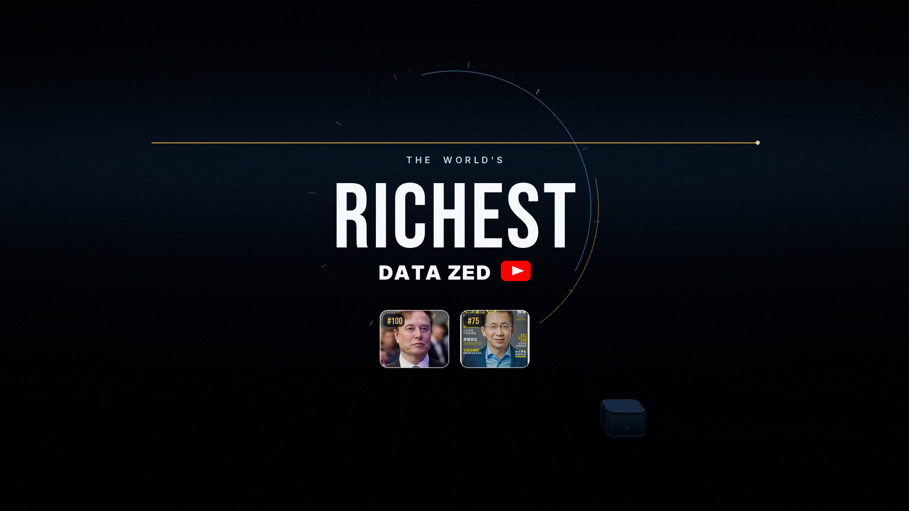
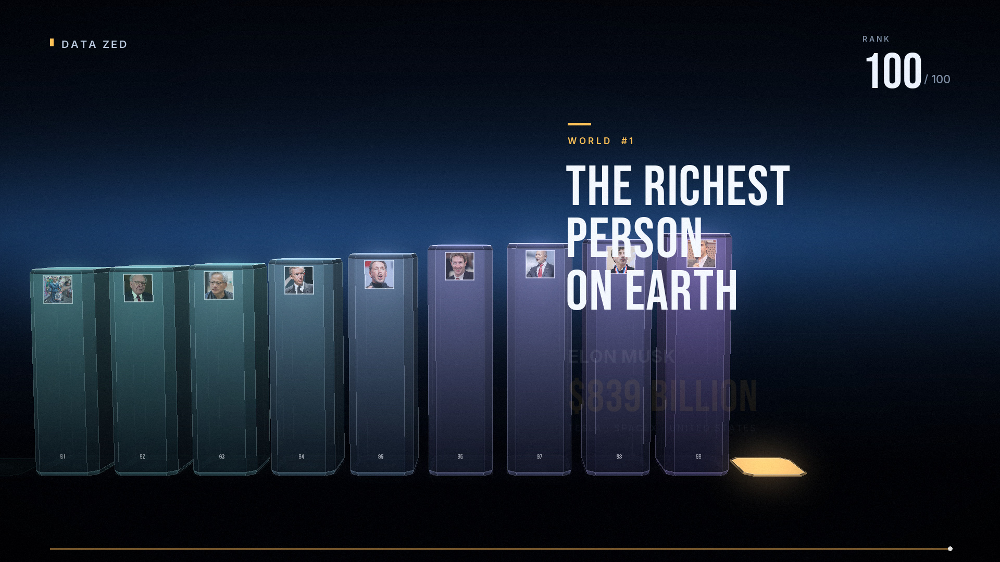

# استوری‌بورد بازبینی — مستند ثروتمندترین افراد، Data Zed

**پیش‌نویس بازبینی · ۱۸۰ ثانیه · ۱۹۲۰×۱۰۸۰ · ۳۰fps · دوربین روبه‌رو · ستون‌های منشوری نرم و مات**

این نسخه بر اساس اصلاحات جدید آماده شده است: ستون‌ها منشورهای مکعبیِ پررنگ و کاملاً مات با گوشه‌های پخ‌دار هستند (نه استوانه)، نام DATA ZED با اندازهٔ برجسته و فاصلهٔ خوانا درست زیر عنوان RICHEST همراه با نشان پخش قرمز YouTube قرار می‌گیرد، عبارت زیرعنوان قبلی حذف شده، و تصاویر مربعِ تأییدشده نزدیک بالای وجه جلوی ستون می‌آیند. عدد تزئینی پشت عنوان حذف شده تا با نوشته‌ها تداخل نکند. نام کانال در HUD نیز بزرگ‌تر شده و کارت پایانی DATA ZED را کنار نشان پخش می‌آورد.

هر تماس‌شیت شامل فریم مکث خواندنی برای ۲۵ رتبه است. ستون فعال در ۴۶٪ نخست نوبتش رشد می‌کند و بعد برای خواندن اطلاعات مکث دارد.

## مقدمهٔ بازطراحی‌شده

## نمونهٔ رشد منشور مکعبی

## فریم‌های مکث هر ۱۰۰ رتبه

در صورت وجود تصویرِ دقیق و دارای مجوز، پنجرهٔ مربعی هم‌اندازه در بخش بالایی وجه جلوی ستون قرار می‌گیرد. هیچ تصویر نامرتبطی جایگزین نشده است. فریم‌های مکث و نمونه‌های این تماس‌شیت‌ها با نسخهٔ ماتِ پررنگ بازتولید و برای هم‌پوشانی آشکار متن، برش و ایرادهای واضح گرافیکی بازبینی شده‌اند.

### رتبه‌های 1 تا 25

| رتبه | زمان فریم مکث (ثانیه) | نام | دارایی خالص تخمینی |
|---:|---:|---|---:|
| 1 | 12.95 | Dilip Shanghvi | $25.6B |
| 2 | 14.41 | Suleiman Kerimov | $25.7B |
| 3 | 15.87 | Israel Englander | $25.8B |
| 4 | 17.33 | Rick Cohen | $26.3B |
| 5 | 18.79 | Jay Y. Lee | $27.0B |
| 6 | 20.25 | Cyrus Poonawalla | $27.0B |
| 7 | 21.71 | Vicky Safra | $27.1B |
| 8 | 23.17 | Pham Nhat Vuong | $27.7B |
| 9 | 24.63 | Daniel Gilbert | $27.9B |
| 10 | 26.09 | Lei Jun | $27.9B |
| 11 | 27.55 | Andreas von Bechtolsheim | $27.9B |
| 12 | 29.01 | Emmanuel Besnier | $28.3B |
| 13 | 30.47 | Leonid Mikhelson | $28.3B |
| 14 | 31.93 | Peter Thiel | $28.4B |
| 15 | 33.39 | Aliko Dangote | $28.5B |
| 16 | 34.85 | Prajogo Pangestu | $28.6B |
| 17 | 36.31 | MacKenzie Scott | $28.6B |
| 18 | 37.77 | Jack Ma | $29.1B |
| 19 | 39.23 | Vagit Alekperov | $29.5B |
| 20 | 40.69 | François Pinault | $29.5B |
| 21 | 42.15 | Susanne Klatten | $29.7B |
| 22 | 43.61 | Vladimir Potanin | $29.7B |
| 23 | 45.07 | Len Blavatnik | $29.9B |
| 24 | 46.53 | Lyndal Stephens Greth | $30.0B |
| 25 | 47.99 | Stefan Quandt | $30.1B |

### رتبه‌های 26 تا 50

| رتبه | زمان فریم مکث (ثانیه) | نام | دارایی خالص تخمینی |
|---:|---:|---|---:|
| 26 | 49.45 | Reinhold Wuerth | $30.1B |
| 27 | 50.91 | Melinda French Gates | $30.3B |
| 28 | 52.37 | Henry Samueli | $30.8B |
| 29 | 53.83 | Elaine Marshall | $30.9B |
| 30 | 55.29 | Shiv Nadar | $30.9B |
| 31 | 56.75 | Lakshmi Mittal | $31.0B |
| 32 | 58.21 | Phil Knight | $31.1B |
| 33 | 59.67 | Michal Strnad | $31.1B |
| 34 | 61.13 | Robert Pera | $31.7B |
| 35 | 62.59 | Marilyn Simons | $32.5B |
| 36 | 64.05 | He Xiangjian | $33.2B |
| 37 | 65.51 | Abigail Johnson | $33.2B |
| 38 | 66.97 | Zheng Shuliang | $33.2B |
| 39 | 68.43 | Eyal Ofer | $33.6B |
| 40 | 69.89 | Idan Ofer | $34.6B |
| 41 | 71.35 | Eric Schmidt | $35.5B |
| 42 | 72.81 | Eduardo Saverin | $35.9B |
| 43 | 74.27 | Colin Huang | $36.6B |
| 44 | 75.73 | Alexey Mordashov | $37.0B |
| 45 | 77.19 | Miriam Adelson | $37.5B |
| 46 | 78.65 | William Ding | $37.9B |
| 47 | 80.11 | Paolo Ardoino | $38.0B |
| 48 | 81.57 | Jean-Louis van der Velde | $38.0B |
| 49 | 83.03 | Stephen Schwarzman | $38.3B |
| 50 | 84.49 | Savitri Jindal | $39.1B |

### رتبه‌های 51 تا 75

| رتبه | زمان فریم مکث (ثانیه) | نام | دارایی خالص تخمینی |
|---:|---:|---|---:|
| 51 | 85.95 | Alain Wertheimer | $39.4B |
| 52 | 87.41 | Gerard Wertheimer | $39.4B |
| 53 | 88.87 | Thomas Frist Jr. | $41.1B |
| 54 | 90.33 | Klaus-Michael Kuehne | $41.9B |
| 55 | 91.79 | Andrea Pignataro | $42.6B |
| 56 | 93.25 | Gianluigi Aponte | $44.5B |
| 57 | 94.71 | Rafaela Aponte-Diamant | $44.5B |
| 58 | 96.17 | Mark Mateschitz | $45.8B |
| 59 | 97.63 | Li Ka-shing | $47.0B |
| 60 | 99.09 | Giovanni Ferrero | $48.8B |
| 61 | 100.55 | Lukas Walton | $48.9B |
| 62 | 102.01 | Jacqueline Mars | $49.1B |
| 63 | 103.47 | John Mars | $49.1B |
| 64 | 104.93 | Ken Griffin | $49.8B |
| 65 | 106.39 | Masayoshi Son | $51.5B |
| 66 | 107.85 | Iris Fontbona | $52.6B |
| 67 | 109.31 | Robin Zeng | $53.2B |
| 68 | 110.77 | Ma Huateng | $53.8B |
| 69 | 112.23 | Tadashi Yanai | $61.8B |
| 70 | 113.69 | Gautam Adani | $63.8B |
| 71 | 115.15 | Germán Larrea Mota Velasco | $67.1B |
| 72 | 116.61 | Dieter Schwarz | $67.2B |
| 73 | 118.07 | Jeff Yass | $67.4B |
| 74 | 119.53 | Zhong Shanshan | $68.1B |
| 75 | 120.99 | Zhang Yiming | $69.3B |

### رتبه‌های 76 تا 100

| رتبه | زمان فریم مکث (ثانیه) | نام | دارایی خالص تخمینی |
|---:|---:|---|---:|
| 76 | 122.45 | Charles Koch | $73.8B |
| 77 | 123.91 | Julia Koch | $81.2B |
| 78 | 125.37 | Thomas Peterffy | $82.9B |
| 79 | 126.83 | Giancarlo Devasini | $89.3B |
| 80 | 128.29 | Mukesh Ambani | $99.7B |
| 81 | 129.75 | Francoise Bettencourt Meyers | $100.0B |
| 82 | 131.21 | Bill Gates | $108.0B |
| 83 | 132.67 | Michael Bloomberg | $109.0B |
| 84 | 134.13 | Changpeng Zhao | $110.0B |
| 85 | 135.59 | Carlos Slim Helu | $125.0B |
| 86 | 137.05 | Steve Ballmer | $126.0B |
| 87 | 138.51 | Alice Walton | $134.0B |
| 88 | 139.97 | Michael Dell | $141.0B |
| 89 | 141.43 | Jim Walton | $143.0B |
| 90 | 142.89 | Rob Walton | $146.0B |
| 91 | 144.35 | Amancio Ortega | $148.0B |
| 92 | 145.81 | Warren Buffett | $149.0B |
| 93 | 147.27 | Jensen Huang | $154.0B |
| 94 | 148.73 | Bernard Arnault | $171.0B |
| 95 | 150.19 | Larry Ellison | $190.0B |
| 96 | 151.65 | Mark Zuckerberg | $222.0B |
| 97 | 153.11 | Jeff Bezos | $224.0B |
| 98 | 154.57 | Sergey Brin | $237.0B |
| 99 | 156.03 | Larry Page | $257.0B |
| 100 | 157.49 | Elon Musk | $839.0B |

## پوشش تصویرها

۶۹ پرترهٔ دقیق و دارای مجوز موجود است؛ برای ۳۱ نفر تصویر مناسب و تأییدشده یافت نشده و قابشان عمداً خالی است. جزئیات در [IMAGE_COVERAGE.md](../IMAGE_COVERAGE.md) و `image_sources.json` است.

## اوج و پایان

## بازبینی

این سند، پیش‌نمایش طرح است؛ MP4 کامل سه‌دقیقه‌ای پس از تأیید استوری‌بورد ساخته می‌شود.
